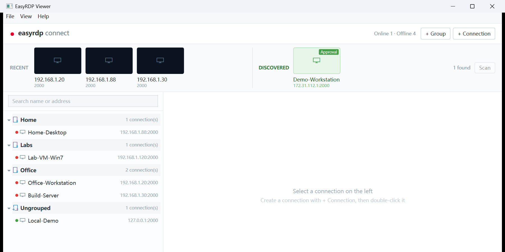
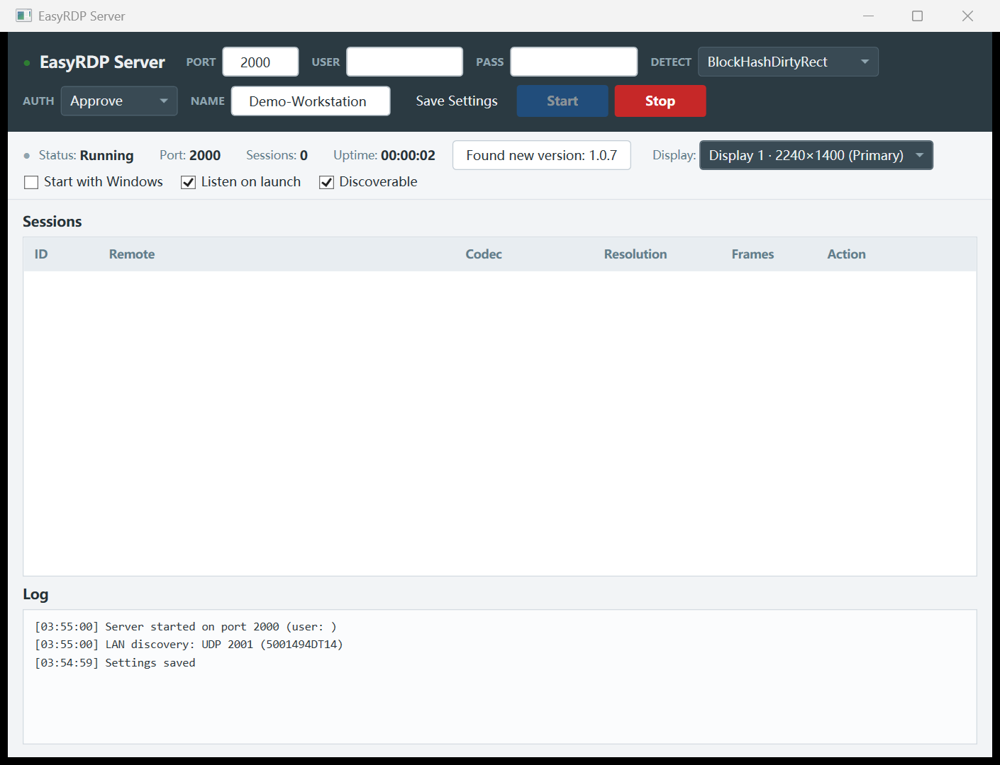
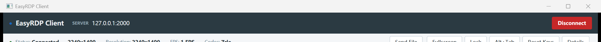

# EasyRDP

自建的 Windows 远程桌面：**服务端兼容 Windows XP（.NET Framework 4.0）**，客户端为 **.NET 8 / WPF**。
自研二进制协议（v5 挑战-响应认证）、ZRLE + H.264 混合编码、独立文件通道、剪贴板延迟传输、
多显示器运行中切换、局域网自动发现。全部内网直连，不依赖任何第三方云服务。



## 特性

| 分类 | 说明 |
|---|---|
| **会话** | 实时画面（ZRLE 差分 + H.264 混合编码，按画面变化率自动切换）、远程光标形状/位置同步、分辨率自适应、断线自动重连（退避 1→10s） |
| **认证** | 两种模式：`Password`（PBKDF2 + HMAC-SHA256 挑战-响应，口令不上网）与 `Approve`（免密码，连接时本机弹窗 Allow/Deny，60s 超时） |
| **连接管理** | 分组树（拖拽归类、右键菜单、搜索）、连接必须先保存（含凭据，DPAPI 加密落盘）、最近使用、详情面板、服务端在线状态与在线/离线统计 |
| **局域网发现** | 服务端可开关 `Discoverable`（UDP 2001）：客户端点 `Scan` 自动列出同网段服务端，与已配置连接去重，一键添加 |
| **文件传输** | 客户端 → 服务端、服务端 → 客户端双向；独立 TCP 通道 + 自适应调速（视频积压时让路），256KB 块 + 滑动窗口，支持拖拽到画面发送 |
| **剪贴板** | 文本、图片、文件三向同步；文件采用「延迟渲染」——复制只发元信息，粘贴时才下载（独立通道，不抢视频带宽） |
| **多显示器** | 服务端可选择采集哪块屏（含运行中切换，自动重建编码器并发关键帧） |
| **服务端运维** | 最小化到托盘（关窗口不停服务）、开机自启、启动即监听、会话列表（踢出 / 发送文件）、审计日志 |
| **诊断与更新** | 连接详情面板（CPU/GPU/内存/OS、FPS、码率、分辨率、RTT）、内置 aly 自动更新 |





## 架构

```
EasyRDP/                       # monorepo
├── src/
│   ├── EasyRDP.Core/          # 协议、编解码器封装、传输层、渲染管线（net40 / netstandard2.0 / net8.0）
│   ├── EasyRDP.Server.Wpf/    # 服务端（net40，可在 Windows XP 上运行）
│   ├── EasyRDP.Client.Wpf/    # 客户端（net8.0-windows，WPF）
│   └── Shared/                # 共享 WPF 样式与行为
├── EasyDesk/                  # 子模块：桌面 I/O（截屏 BitBlt/DXGI、键鼠注入、光标、剪贴板）
├── aly/                       # 子模块：自动更新（服务端 + 客户端 SDK）
├── docs/                      # 设计文档与排障记录
└── test/
```

数据管线：`Capture → Encode → Transport → Decode → Render`，由 Session 编排；
传输层可插拔（TCP / UDP / WebSocket 均有实现，默认 TCP）。

## 快速开始

### 环境要求

- **服务端**：Windows XP SP3 及以上 + .NET Framework 4.0
- **客户端**：Windows 10 / 11 + .NET 8 桌面运行时
- **构建**：.NET SDK 8+（构建服务端还需 .NET Framework 4.0 参考程序集，安装 VS 或 Build Tools 即可）

### 构建

```bash
git clone --recursive https://github.com/lishuangquan1987/EasyRDP.git
cd EasyRDP

dotnet build src/EasyRDP.Server.Wpf/EasyRDP.Server.Wpf.csproj -c Release
dotnet build src/EasyRDP.Client.Wpf/EasyRDP.Client.Wpf.csproj -c Release
```

产物：

- 服务端 `src/EasyRDP.Server.Wpf/bin/Release/net40/`
- 客户端 `src/EasyRDP.Client.Wpf/bin/Release/net8.0-windows/`

> 未拉取子模块时先执行 `git submodule update --init --recursive`。

### 第一次连接（3 步）

**1. 启动服务端**，选择认证模式后点 `Start`：

- `AUTH = Password`：填写 `USER` / `PASS`（客户端要用同样的凭据）
- `AUTH = Approve`：不用密码，连接时本机弹窗点 `Allow`

需要局域网自动发现时勾选 `Discoverable`；勾选 `Listen on launch` 可开机后自动监听。

**2. 客户端新建连接**：启动客户端 → 右上角 `+ Connection` → 填写
名称 / 地址 / 端口 / 用户名 / 密码 → 保存并连接。

**3. 或直接发现**：客户端顶部 `DISCOVERED` 右侧点 `Scan`，同网段内开启发现的
服务端会出现在列表中（已配置的机器不会重复出现），点击卡片补齐凭据即可连接。

## 使用说明

| 操作 | 方式 |
|---|---|
| 全屏 / 退出全屏 | `F11` / `Esc` |
| 发送文件 | 工具栏 `Send File`，或直接把文件拖到远程画面 |
| 锁定远程桌面 | 工具栏 `Lock`（Win+L）；`Ctrl+Alt+Del` 是安全注意序列，无法模拟 |
| 切换远程窗口 | 工具栏 `Alt+Tab` |
| 按键卡住 | 工具栏 `Reset Keys`（释放 Ctrl/Alt/Shift/Win） |
| 查看连接详情 | 工具栏 `Details`（CPU/GPU/内存/OS、FPS、码率、RTT、缩放） |
| 缩放模式 | `Cycle Zoom`：适应窗口 / 1:1（按 DPI 精确映射）/ 拉伸 |
| 服务端最小化 | 关闭服务端窗口（服务继续运行），托盘菜单可 Show / Start / Stop / Exit |

## 端口与数据位置

| 用途 | 位置 |
|---|---|
| 业务端口 | TCP **2000**（可在服务端界面修改） |
| 局域网发现 | UDP **2001**（服务端 `Discoverable` 关闭后不再应答） |
| 客户端配置 | `%APPDATA%\EasyRDP\client\`（`connections.json` / `groups.json` / `recent.json`，密码经 DPAPI 加密） |
| 服务端配置 | `%APPDATA%\EasyRDP\server\settings.json` |
| 接收的文件 | 客户端：`下载\EasyRDP Received`；服务端：`我的文档\EasyRDP Received` |
| 审计日志 | 服务端 `Logs\audit-YYYY-MM-DD.log`（连接/断开/时长/认证失败/审批/踢出/文件收发） |

## 安全说明

- 口令模式使用 **PBKDF2-HMAC-SHA256** 派生 + **HMAC** 挑战-响应，口令本身不在网络上传输；
  服务端常量时间比对，盐与迭代次数可配置。
- 文件通道使用握手下发的 16 字节 token 鉴权，并校验来源 IP 与会话一致。
- 局域网发现只回显 **名称 / 端口 / 认证模式 / 是否已满**，不含任何凭据；仅应答私网与回环地址，并限速 10 次/秒。
- ⚠️ **画面与文件通道本身未加密**，请只在可信内网或 VPN 中使用。

## 已知限制

- 仅 Windows 服务端与客户端；Linux/macOS 采集在 EasyDesk 路线图中。
- 一次只共享一块屏（可在运行中切换，但不做多屏拼接）。
- `Ctrl+Alt+Del` 无法模拟（Windows 安全注意序列）。
- 局域网发现依赖广播域：跨网段 / VPN / 云主机通常发现不到（可手动填写地址）。
- Windows 11 若启用剪贴板历史等工具，复制文件时系统可能主动读取剪贴板，
  导致「粘贴才传输」的延迟被缩短（XP / 7 / 10 不受影响）。
- 无音频转发。

## 开发

```bash
# 只构建核心库（三种目标框架）
dotnet build src/EasyRDP.Core/EasyRDP.Core.csproj

# EasyDesk（子模块）测试：会真实操作鼠标/键盘/剪贴板，运行时勿动机器
dotnet test EasyDesk/test/EasyDesk.Windows.Tests/EasyDesk.Windows.Tests.csproj
```

- 服务端必须保持 `net40` 单一目标（XP 兼容），禁止引入 C# 6+ 语法特性。
- 设计规范见 `docs/EasyRDP-Abstraction-Layers-Design.md`，排障记录见 `docs/EasyRDP-Troubleshooting.md`。

## 发布与安装包

在 GitHub 上创建并发布 Release（tag 形如 `v1.2.3`）会自动触发
[`.github/workflows/release.yml`](.github/workflows/release.yml)：

1. `windows-latest` 上构建客户端（自包含 win-x64，免装 .NET 运行时）与服务端（net40）；
2. 用 Inno Setup 生成 `EasyRDP-Client-<版本>-Setup.exe` 与 `EasyRDP-Server-<版本>-Setup.exe`；
3. 额外产出 `EasyRDP-Server-<版本>-portable.zip`（**Windows XP 请用这个**，
   Inno Setup 6 的安装包最低支持 Windows 7）；
4. 所有产物同时上传到 Actions Artifacts 和该 Release。

安装包默认安装到用户目录（`%LOCALAPPDATA%\EasyRDP\{Client|Server}`），
无需管理员权限——服务端日志与自动更新器都需要程序目录写权限。
卸载不会删除 `%APPDATA%\EasyRDP` 下的连接配置与审计日志。

也可在 Actions 页面手动运行该 workflow（`workflow_dispatch`）输入版本号，做预发布验证。

## 反馈

欢迎提交 Issue / PR。请附上服务端与客户端日志（`Logs/` 目录）以及复现步骤，
涉及画面问题时附截图或录屏会更快定位。
